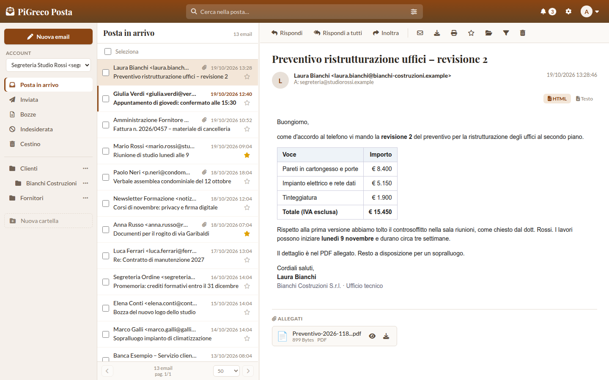
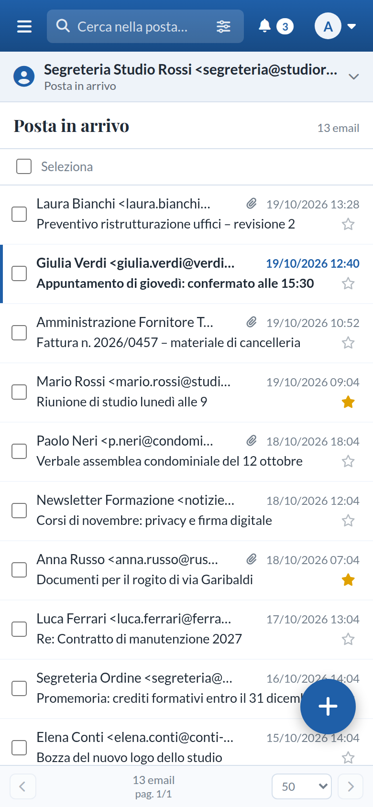
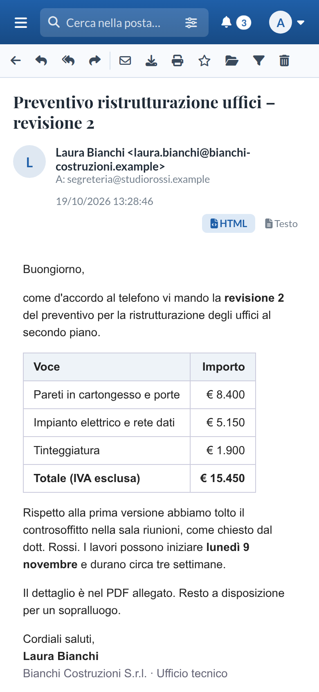
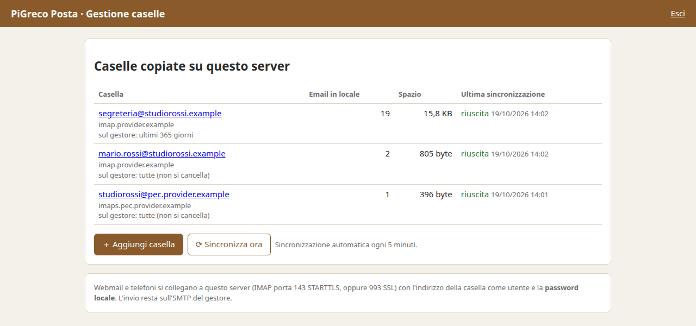

# PiGreco Posta

**Keep a copy of all your mailboxes on your own server and read them with a modern webmail, with one `docker compose up`.**

*[Leggi in italiano](README.it.md)*

PiGreco Posta is a self-hosted mail kit for small offices, professional firms and anyone whose provider mailbox is always full:

```
provider (Gmail, Libero, Aruba, PEC…) ──IMAP──▶ local copy on your disk ──IMAP──▶ webmail, phones, Thunderbird
                                     mbsync                      Dovecot
```

- **Local copy of the provider mailboxes.** Every few minutes new mail and flags are copied from the provider (IMAP, `mbsync`) to a Maildir on your server, served by Dovecot. The copy **never deletes anything**. Space depends on your disk, not on the provider's quota.
- **Free space at the provider, safely (optional).** For each mailbox you can keep only the last N days on the provider. An email is deleted from the provider **only if its local copy has been verified**. The default is 0: nothing is ever deleted.
- **Webmail.** Multi-account, multi-user. Three-pane layout that also works on phones. Search, folders, drag & drop, multi-select, drafts with autosave, important ⭐, server-side **filters**, colour themes. Sending goes through each provider's own SMTP.
- **"Gestione caselle" web page** to add mailboxes, test the provider login, see sync status and set the cleanup.
- **Everything in Docker**: webmail (PHP 8.3 + Apache), MySQL 8, Dovecot, mbsync, management page.

The user interface is in **Italian** for now. Translations are welcome.

## Screenshots



<p align="center">
  
  &nbsp;&nbsp;
  
</p>



*All names, addresses and messages in the screenshots are made up.*

## Requirements

- Linux server (or a PC that stays on) with **Docker** and the **compose** plugin.
- Free ports: 8080 (webmail), 8083 (management page), 143/993 (IMAP for phones and mail clients). All of them can be changed in `.env`.

## Install

```bash
git clone https://github.com/ddcls/pigreco-posta.git
cd pigreco-posta
./installa.sh
```

`installa.sh` creates `.env` with random passwords and encryption key, builds and starts the containers, and asks for the passwords of the webmail `admin` user and of the management page. Re-running it is safe. It keeps a root-only copy of `.env` in `/srv/posta/config/`, so a fresh copy of the program (e.g. a new ZIP) picks up the existing data and passwords.

Then:

1. **Gestione caselle**, `http://<server>:8083`: add the mailboxes (address, provider login). The page shows the **local password** of each mailbox once.
2. **Webmail**, `http://<server>:8080/webmail/`: log in as `admin` and go to *Impostazioni › Account Email*. For each mailbox set IMAP server `posta`, port 143, STARTTLS, user = email address, password = local password. For SMTP use the provider's server.

The full guide, in Italian, is in [`manuale/manuale.md`](manuale/manuale.md) (also as PDF: [`manuale/manuale.pdf`](manuale/manuale.pdf)). For a fresh **Debian** server (sudo, static IP, Docker, install, backups) there is a step-by-step guide, also in Italian: [`INSTALLA-DEBIAN.md`](INSTALLA-DEBIAN.md).

**Microsoft mailboxes** (hotmail/outlook/live/Microsoft 365) only allow OAuth2 and cannot be copied. Gmail, Yahoo and iCloud need an *app password*.

## Useful commands

```bash
docker compose ps                         # status
docker compose logs -f posta-sincronizza  # sync log
./scripts/password-webmail.sh [user]      # set a webmail password
./scripts/password-gestione.sh [user]     # set the management page login
sudo ./scripts/backup.sh <folder>         # back up mailboxes, database and .env in one file
./scripts/confronta.sh [address]          # compare provider vs local counts, folder by folder
git pull && docker compose up -d --build  # update
```

Mailboxes and database live in `/srv/posta`: `sudo ./scripts/backup.sh <folder>` backs them up in a single file, together with `.env`. Keep that file safe: `.env` holds the encryption key of the saved passwords.

## Security notes

- Put the webmail behind HTTPS (a reverse proxy such as Caddy, nginx or Traefik) before exposing it to the Internet. Keep the management page (port 8083) on the LAN only.
- IMAP/SMTP passwords are stored encrypted (AES-256-GCM, key in `.env`). The HTML body of emails is shown in a sandboxed iframe, without scripts.
- The Dovecot certificate created at first start is self-signed. Replace `/srv/posta/config/ssl/cert.pem` and `key.pem` with a real one before using the mail from phones outside the office.
- Found a vulnerability? See [SECURITY.md](SECURITY.md): please report it privately, not in a public issue.

## PiGreco Archivio

PiGreco Posta is made by the authors of **PiGreco Archivio**, a document archive for offices and law firms (3D office, folders, OCR, legal module). When PiGreco Archivio is installed on the same server, it connects to the webmail you already have, with no reinstall and no data loss. You get the **Archivia** button (archive an email and its attachments with one click), a shared address book, and archive documents sent from your own mailbox.

## License

[GNU Affero General Public License v3.0](LICENSE). You may use, study, modify and share it. If you offer a modified version as a network service, you must publish your changes under the same license.

Third-party components and their licenses: [THIRD-PARTY.md](THIRD-PARTY.md).
